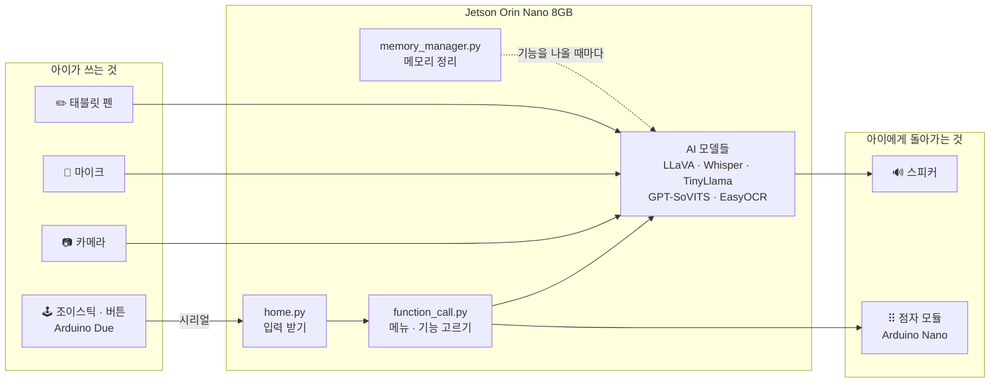
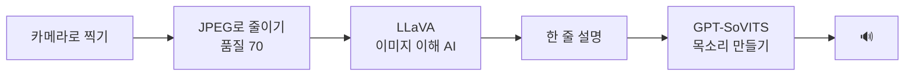
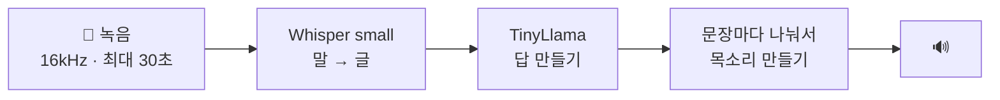
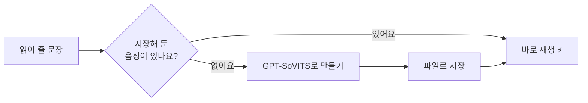
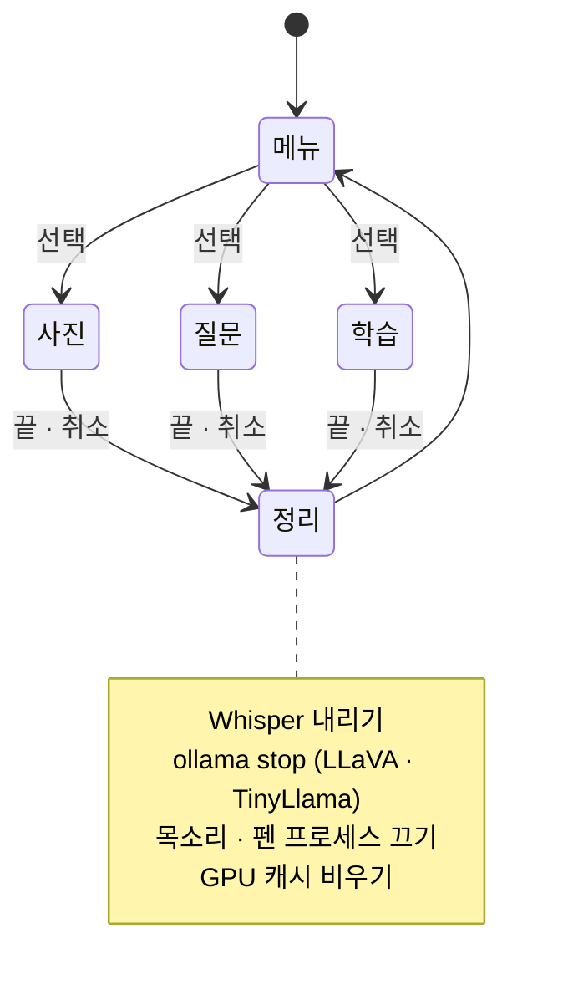

<div align="center">

# 설몽 (Snowdream)

**시각장애 아동의 문맹률을 낮추기 위한, 저비용 다국어 학습 기기**


🎬 **시연 영상** — https://youtu.be/vkroyZ2OPqw


</div>

---

설몽은 앞이 보이지 않는 아이도 **혼자서 글자를 배우고, 사진을 듣고, 묻고, 동화를 즐길 수 있게** 만든 학습 기기예요.
화면을 보지 않아도 되도록 모든 조작은 **조이스틱과 버튼**으로, 모든 안내는 **목소리와 점자**로 돌아와요.
AI는 전부 Jetson 안에서 돌아가서, 인터넷이 없어도 쓸 수 있어요.

## 한눈에 보기

| | 기능 | 이렇게 동작해요 |
|---|---|---|
| 📷 | **사진** | 카메라로 찍으면 AI가 무엇이 보이는지 한 줄로 말해 줘요 |
| ✍️ | **학습** | 읽기 — 단계별 단어를 점자로 짚어 주고 소리 내어 읽어 줘요<br>쓰기 — 펜으로 쓴 글자를 알아보고 맞는지 알려 줘요 |
| 🎤 | **질문** | 궁금한 걸 말로 물으면 AI가 답을 목소리로 들려줘요 |
| 📖 | **동화** | 동화를 골라 한 줄씩 읽어 줘요. 동화마다 한국어 · 영어 글을 함께 둬요 |

## 기기 구성



- **Jetson Orin Nano 8GB** — 모든 AI와 메뉴 흐름이 여기서 돌아가요.
- **Arduino Due** — 조이스틱(상하좌우)과 버튼 두 개(선택 · 취소)를 읽어 Jetson으로 보내요.
- **Arduino Nano** — 점자 모듈을 움직여 단어를 손끝으로 읽게 해 줘요.
- 두 아두이노는 켜질 때 보내는 첫 인사(`JOYSTICK_READY` · `BRAILLE_MOTOR_READY`)로 **자동으로 구분**돼요. 어느 USB에 꽂아도 괜찮아요.

## 이렇게 조작해요


- **위 · 아래** — 기능을 차례로 옮겨 다녀요. 옮길 때마다 "사진", "학습"처럼 목소리로 알려 줘요.
- **선택 버튼** — 지금 기능으로 들어가요.
- **취소 버튼** — 어디에 있든 바로 처음 메뉴로 돌아와요.

아이가 버튼을 여러 번 눌러도 엉키지 않도록 몇 가지를 챙겼어요.
- 아두이노는 Jetson이 "처리했어요" 신호를 보내기 전까지 다음 입력을 보내지 않아요(입력 쌓임 방지).
- 버튼은 0.5초 안에 다시 눌러도 한 번으로 쳐요.
- 기능을 옮길 때는 안내 음성이 끝날 시간(2초)을 두고 넘어가요.

---

## 기능별로 들여다보기

### 📷 사진 — 보이는 걸 말로



AI에게는 *"이 사진에 무엇이 보이나요? 한 줄로 간단히 설명해 주세요."* 라고 물어요.
기다리는 동안에는 "인공지능이 사진을 분석하고 있습니다" 같은 안내가 먼저 나와서, 아이가 기다리는 이유를 알 수 있어요.

### 🎤 질문 — 말로 묻고 말로 듣기



답을 한꺼번에 만들지 않고 **문장 단위로 목소리를 만들어 바로바로** 들려줘요. 그래서 긴 답도 첫 문장이 금방 나와요.

### ✍️ 학습 — 점자와 목소리로 함께

- **읽기** — 1 · 2 · 3단계 중 하나를 고르면 단어가 하나씩 나와요. 점자 모듈이 먼저 단어를 짚어 주고, 이어서 목소리로 읽어 줘요. 선택 버튼을 누르면 다음 단어로 넘어가요.
- **쓰기** — 태블릿에 펜으로 글자를 쓰면 그림으로 바꿔 EasyOCR이 읽어요. 무엇을 썼는지 목소리로 알려 줘요.

### 📖 동화 — 두 나라 말로

위 · 아래로 동화를 고르고 선택 버튼을 누르면 제목부터 한 줄씩 읽어 줘요. 동화마다 한국어 · 영어 글을 함께 두는 구조라, 다른 언어로 넓히기도 쉬워요(지금은 한국어로 읽는 게 기본이에요).

---

## 데이터는 이렇게 다뤄요

학습 기기는 **같은 내용을 여러 번** 들려줘야 하고, Jetson은 **메모리가 8GB뿐**이에요. 그래서 데이터를 담는 방식부터 이 두 가지에 맞췄어요.

### 1. 교재와 동화는 사람이 고치기 쉬운 글 파일로

선생님이나 보호자가 코드를 몰라도 내용을 바꿀 수 있도록, 교재와 동화를 **그냥 글 파일**로 두었어요.

**읽기 교재** — `function_study/function_read.txt` (아래는 모양을 보여 주는 예시예요)
```
===1단계===
1. 강
2. 산
===2단계===
1. 바다
...
```
`===n단계===` 머리 아래에 번호 붙은 단어를 적으면, 기기가 단계별 단어 목록으로 읽어 들여요.

**동화** — `function_textbook/<동화 이름>/` (예시)
```
function_textbook/
└── 토끼와 거북이/
    ├── 토끼와 거북이_kor.txt   ← 한국어, 한 줄 = 한 번에 읽는 문장
    └── 토끼와 거북이_eng.txt   ← 영어
```
폴더 하나에 언어별 파일(`_kor` · `_eng`)을 넣으면 새 동화가 바로 목록에 나타나요. 다른 언어도 같은 방식으로 늘릴 수 있어요.

### 2. 목소리는 한 번 만들고 계속 꺼내 써요

자연스러운 목소리(GPT-SoVITS)는 듣기 좋지만, Jetson에서 만드는 데 시간이 걸려요. 그래서 **처음 한 번만 만들고 파일로 저장**해 둬요.



- 메뉴 안내 · 기능 안내는 미리 만든 소리 파일(`sound/`, `audio_prompts/`)을 써요.
- 동화는 `<동화>_<언어>_<줄 번호>.wav`로 줄마다 저장해요. 두 번째부터는 기다림 없이 읽어 줘요.
- 사진 분석 중 안내처럼 자주 나오는 말은 `tts_cache/`에 모아 둬요.

### 3. 8GB 안에서 AI 여러 개를 돌리는 법

LLaVA · Whisper · TinyLlama · GPT-SoVITS · EasyOCR을 한꺼번에 올리면 8GB가 모자라요. 그래서 **지금 쓰는 기능의 모델만 올리고, 나올 때 바로 내려요.**



- 사진 기능은 LLaVA만, 질문 기능은 Whisper와 TinyLlama만 써요.
- 취소 버튼을 누르면 `memory_manager.py`가 위 정리를 한 번에 하고 메뉴로 돌아와요. 오래 써도 느려지거나 멈추지 않게 하려는 장치예요.
- 사진은 JPEG 품질 70으로 줄여서 AI에 보내요. 메모리와 시간을 아끼기 위해서예요.

---

## 설치하고 실행하기

### 1. 환경 만들기

```bash
git clone https://github.com/BrDoom/2025ESWContest_free_snowdream.git
cd 2025ESWContest_free_snowdream

# 메인 환경
conda create -n snowdream python=3.8
conda activate snowdream
pip install pygame pillow evdev numpy pyserial pyaudio requests psutil openai-whisper opencv-python

# 글자 인식(쓰기 모드) 환경
conda create -n cnn_env python=3.8
conda activate cnn_env
pip install easyocr torch torchvision
```

그 밖에 이것들이 필요해요.
- **Ollama** — `ollama pull llava`, `ollama pull tinyllama` 후 `ollama serve`
- **GPT-SoVITS** — `GPTSoVits` conda 환경과 기준 목소리 파일(`function/route.py`의 `REF_AUDIO_PATH`)

### 2. 경로 맞추기

소리 · 교재 · 동화 폴더 경로가 코드 위쪽에 적혀 있어요. 내 환경에 맞게 바꿔 주세요.

| 파일 | 바꿀 곳 |
|---|---|
| `function_call.py` | `SOUND_DIR` |
| `function/function_picture.py` | `PHOTO_SOUND_DIR`, `TTS_CACHE_DIR` |
| `function/function_story.py` | `TEXTBOOK_DIR` |
| `function/route.py` | `REF_AUDIO_PATH`, `GPT_SOVITS_DIR` |

### 3. 권한과 실행

```bash
# 태블릿 펜 입력 장치를 읽을 수 있게
sudo usermod -a -G input $USER
sudo chmod 666 /dev/input/event*

python run_system.py test   # 환경 점검
python run_system.py        # 실행 (또는 sudo python home.py)
```

## 저장소 구성

```
├── home.py                  # 시작점 — 아두이노 입력을 받아 기능으로 넘겨요
├── function_call.py         # 메뉴 순환 · 기능 실행 · 상태 관리
├── navigation_system.py     # 메뉴 단계(메인 · 학습 · 동화 …) 관리
├── memory_manager.py        # 모델 내리기 · 프로세스 정리 · GPU 캐시 비우기
├── connect_arduino.py       # 아두이노 자동 찾기 · 시리얼 통신
├── run_system.py            # 환경 점검과 실행
├── arduino_swipe.ino        # 조이스틱 · 버튼 (Arduino Due)
├── arduino_hardware_test.ino
└── function/
    ├── function_picture.py  # 사진
    ├── function_learning.py # 학습 (읽기 · 쓰기)
    ├── function_question.py # 질문
    ├── function_story.py    # 동화
    ├── route.py             # 목소리 만들기 (GPT-SoVITS)
    └── interaction_handler.py
```

> 점자 변환 모듈과 쓰기 모드의 펜 입력 · 글자 인식 코드, 소리 · 교재 · 동화 파일은 이 저장소에 들어 있지 않아요.

## 쓰는 기술

| 하는 일 | 쓴 것 |
|---|---|
| 사진 이해 | LLaVA (Ollama) |
| 말 → 글 | Whisper small |
| 답 만들기 | TinyLlama (Ollama) |
| 글 → 목소리 | GPT-SoVITS |
| 손글씨 읽기 | EasyOCR |
| 카메라 · 이미지 | OpenCV · Pillow |
| 소리 재생 · 녹음 | pygame · PyAudio |
| 아두이노 통신 · 펜 입력 | PySerial · evdev |

## 팀 설몽 (Snowdream)

| 역할 | 이름 |
|---|---|
| 팀장 | 박민규 |
| 팀원 | 이승현 · 이승주 · 김현수 · 김민석 |

<div align="center">

*2025 임베디드 소프트웨어 경진대회 자유공모 출품작*

</div>
